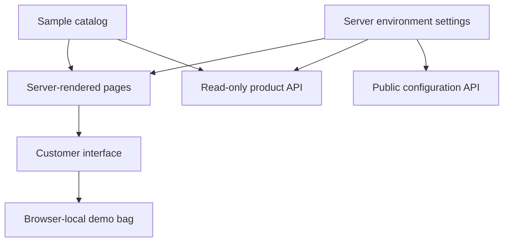

# OANRO — Diagram Edition, v0.2.0

This is the completed **frontend design milestone**, built from Rosan's diagram and the agreed green, off-white, black and gold palette. It is not yet a live commerce system. All merchandise, prices, photographs and the headphone model are demonstration content.

## Start safely on Ubuntu

Extract the ZIP into a **new folder first**, rather than deleting your existing `~/oanro-web`. Open the extracted `oanro-final` folder in VS Code and open its terminal.

```bash
npm ci
npm run dev
```

Open the local address printed in the terminal. Use a supported Node version for the bundled Next.js release; check the installed package's `engines` field if npm reports an engine warning. Development needs network access for the initial package installation and Google font download.

**কেন নতুন folder?** আগের কাজ নিরাপদ থাকবে; এই সম্পূর্ণ version দেখে তারপর মূল project-এ নেওয়া যাবে। শুধু `page.tsx` paste করলে হবে না—এবার components, images, video এবং dependencies-ও আছে।

After reviewing, merge `src/`, `public/`, and the supplied project configuration into your existing repository deliberately. Keep your existing `.git`, `AGENTS.md`, secrets, and unrelated work. `package.json` and `package-lock.json` are a matched pair. Never copy `node_modules` or `.next` between projects. Run `npm ci` after adopting the package files.

```bash
npm run lint
npm run typecheck
npm run build
npm start
```

If your environment blocks Turbopack's worker sockets, the supported alternative is `npx next build --webpack`; for development, `npm run dev -- --webpack`. Do not disable TypeScript or lint checks to hide errors. This delivery's production build was verified with webpack because the test environment blocked Turbopack sockets.

## What changed and why

| Diagram request | Implementation | Benefit |
| --- | --- | --- |
| Separate slogan header | Message strip above navigation | Keeps the brand message without crowding the opening |
| Products / Services / About navigation | Responsive mega menus; Contact under About | Clear entry points on desktop and mobile |
| Search and bag icons | Search dialog and persistent local demo bag | Interactions work during design review |
| Intro and animated logo | Rebuilt A/ring SVG, flip and energy rings | Short brand introduction; skip available |
| Smaller OANRO Standard | Particle scene and sequential lettering | Compact, animated brand promise |
| Animated value cards | Scroll fan-out and hover product thumbnails | A visual transition into the collection |
| Separate discovery links | Dedicated exploration strip | Keeps navigation apart from hero copy |
| Cinematic product presentation | Knitwear and headphone campaign sections | Large, purposeful product imagery |
| Rich product details | Four product routes, media controls, specs and sample sizes | Real navigable detail pages, not dead cards |
| Moving product and service rows | Independent looping carousels with pause and arrows | Products and services stay distinct |
| Separate partners | Partner Picks section | Keeps partner merchandising separate |
| Switch sections before launch | Server environment settings | Hide unfinished offerings without an unsecured admin |

The diagram's logo was interpreted as an original vector monogram, not recovered as an exact original logo file. The supplied diagram was a raster reference. Reference-brand layouts were used as inspiration only; no brand logos or product claims were copied.

## Project map

| File or directory | Responsibility |
| --- | --- |
| `src/app/layout.tsx` | Metadata, fonts, global shell and server configuration |
| `src/app/page.tsx` | Homepage section order |
| `src/app/globals.css` | Palette, spacing, responsive layouts and animations |
| `src/app/products/[slug]/page.tsx` | Product routing, metadata and not-found behavior |
| `src/components/shell.tsx` | Header, mega menus, search, demo bag and footer |
| `src/components/home-experience.tsx` | Campaigns, carousels and value-card animation |
| `src/components/scene.tsx` | Procedural Three.js universe and headphone model |
| `src/components/product-detail.tsx` | Gallery, sizes and add-to-demo-bag interaction |
| `src/components/experience.tsx` | Motion preference, intro and reveal behavior |
| `src/lib/catalog.ts` | Sample product/service data; edit content here |
| `src/lib/cart.ts` | Local-only demo bag, validation and persistence |
| `src/lib/site-config.ts` | Server-only section settings |
| `src/app/api/` | Read-only demo API endpoints |
| `public/images/` | Bundled generated product and campaign assets |
| `public/media/` | Animated-still video in WebM and MP4 |
| `public/logo.svg` | Original rebuilt monogram |
| `tests/` | Development smoke and motion tests |

Separating data, layout and interaction keeps later changes localized. For example, change a product in `catalog.ts`, not in every card. Keep the installed Next.js guides and your existing `AGENTS.md` instructions authoritative when adding framework APIs.

## API handling and current data flow



- `GET /api/products`: returns `{ demo: true, products: [...] }`.
- `GET /api/products?q=winter`: searches sample name/category; query capped at 120 characters.
- `GET /api/site-config`: exposes only the deliberate public settings, not environment secrets.
- Disabled products return an empty product list; product detail routes return 404.
- Pages import the server catalog directly; they do not make wasteful HTTP requests to their own API. Client search uses the small bundled sample catalog.
- These are **not** order/payment/admin APIs. The demo bag is untrusted browser data and must never become an authority for prices, stock, permissions or payment success.

## Section settings

Copy `.env.example` to `.env.local`, set values, then restart the server:

```dotenv
OANRO_PRODUCTS=true
OANRO_SERVICES=true
OANRO_PARTNERS=true
OANRO_FEATURES=true
OANRO_INTRO=true
OANRO_CONTACT_EMAIL=
```

Set a flag to `false` to hide the corresponding section. Hiding products also hides dependent partner/campaign content and product links. Set only your chosen **public business email**; no personal address was assumed. An empty email shows an honest contact-coming-soon message, not a nonfunctional submission form.

These are deployment settings, **not the requested future admin dashboard**. The secure dashboard will later control stored settings with authorization, approval rules and audit logs. Do not add a publicly writable settings endpoint as a shortcut.

## Generated assets

Four image files are bundled; `products.png` contains four square product tiles in a 2×2 atlas. This avoids remote image dependencies. CSS background positions select the relevant tile.

| Asset | Content / generation direction |
| --- | --- |
| `products.png` | Unbranded forest-green knitwear, charcoal overshirt, winter accessories and black headphones; neutral studio backgrounds |
| `campaign.png` | Adult South Asian male model in a forest-green cable-knit sweater; premium editorial winter campaign with open space for copy |
| `fabric.png` | Macro forest-green cable-knit textile with detailed fibers and soft light |
| `headphones.png` | Matte-black over-ear headphone concept, dark sculptural studio composition |

These descriptions summarize the generation direction, not exact archived prompt transcripts. All images are AI-generated placeholders, not supplier photos or verified depictions of saleable inventory. The video is a six-second zoom of a generated still, **not filmed footage**. The Three.js headphone is a procedural illustrative model, not engineering geometry. Replace sample prices, images and specifications before accepting orders. Product size labels are also examples.

## Accessibility and motion

- Intro appears once per tab session, can be skipped, and is suppressed for reduced-motion preference.
- Native dialogs support keyboard closing; controls have accessible labels.
- Carousels pause on hover and stop on user interaction; arrows remain available.
- Footer motion control and system reduced-motion preference disable automatic movement.
- 3D pauses when offscreen/hidden and offers manual rotation; a photo fallback appears if WebGL initialization fails.
- Images remain useful without the 3D model. Video does not autoplay or play sound.
- Responsive CSS covers small phones through desktop; actual Safari, iOS, Android and Windows device testing is still required before launch. No claim of perfect behavior on every device is made.

## Validation and limits

See `VERIFICATION.md` for the exact checks and results. Test scripts use Playwright from the verification environment; it is not included as a production dependency. To rerun them locally, install Playwright as a development dependency and Chromium, set `CHROMIUM_PATH` to your installed browser, and run a preview server on port 3100.

## Next milestones — not implemented here

1. Approve frontend, replace placeholder content, add English/Bangla localization.
2. Design database and migrations; implement products/variants/stock/suppliers and staff authorization.
3. Build secure admin: configurable sections, scoped roles, limited delegation, second approvals and audit history.
4. Implement server-priced carts/orders, delivery zones, combined charges, multi-shipment tracking and customer accounts/guest access.
5. Add approved payment gateway integration and verified, idempotent webhook handling; never trust browser payment messages.
6. Add inquiries, support requests, refund/return workflows, email updates and verified delivered-and-paid reviews.
7. Add reporting, backup/restore, monitoring, security tests, accessibility/device testing and production launch checks.

Revenue, cost, fees, refunds and profit must use authoritative business records and deterministic calculations. Future AI forecasts should be labelled estimates and must not override financial records or staff authorization.

**বাংলায় সারাংশ:** এই package-এ website-এর design, animation, fake product image, product details, search ও demo bag শেষ করা হয়েছে। আসল order, payment, database এবং permission-controlled admin পরের milestone—এগুলো তৈরি হয়েছে বলে ধরা যাবে না।
